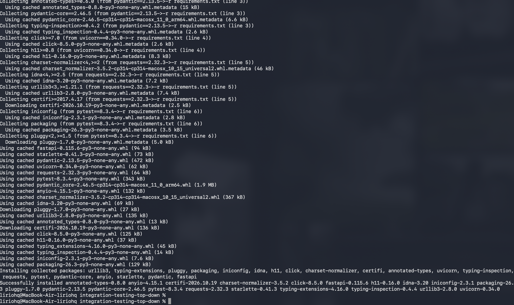
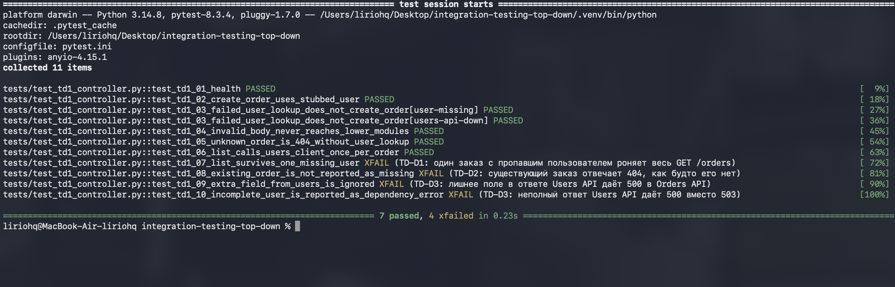
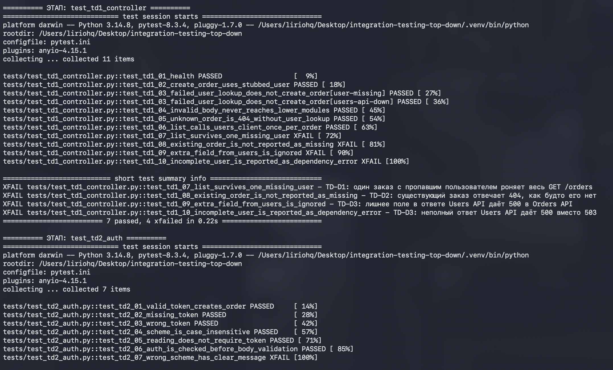
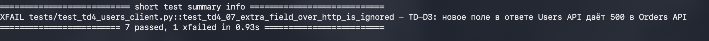
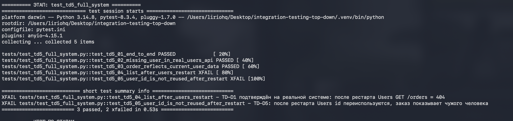
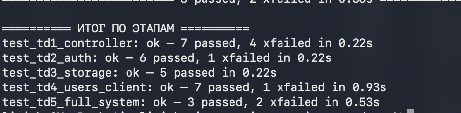
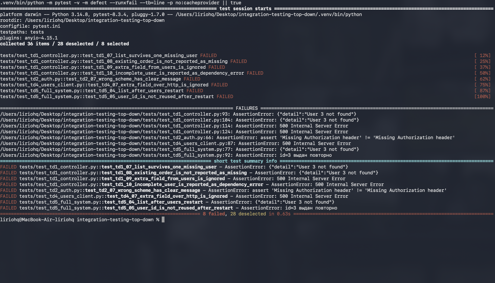

# Интеграционное тестирование методом «сверху вниз»

Лабораторная по курсу «Интеграционное тестирование».

По заданию метод применяется «сверху вниз»: сначала проверяется верхний модуль, контроллер, а модули под ним заменяются заглушками. Потом заглушки по одной меняются на настоящие модули, и тесты запускаются после каждого шага. В конце разбираются найденные ошибки и то, насколько метод помог их найти.

Отчёт: [`report/otchet-top-down.md`](report/otchet-top-down.md), тот же текст в Word — `report/Otchet-top-down.docx`.

## Проект

Учебный проект с прошлых работ: два сервиса на FastAPI, данные хранятся в памяти.

| Сервис | Что делает |
|---|---|
| Users API | Пользователи. При запуске уже есть Анна (id=1) и Пётр (id=2) |
| Orders API | Заказы. При создании и чтении заказа запрашивает пользователя в Users API |

```
клиент ──► Orders API ──GET /api/v1/users/{id}──► Users API
```

Код сервисов лежит в `users_service/` и `orders_service/`.

Верхний модуль — контроллер Orders API, файл `orders_service/app/main.py`: к нему обращается клиент. Под ним проверка токена (`auth.py`), хранилище заказов (`storage.py`) и HTTP-клиент к Users API (`users_client.py`).

## Этапы

На каждый этап свой файл в `tests/`. Заглушки — в `tests/stubs.py`.

| Этап | Файл | Что уже настоящее | Что ещё заглушка |
|---|---|---|---|
| 1 | `test_td1_controller.py` | контроллер Orders API | auth, storage, users_client |
| 2 | `test_td2_auth.py` | + проверка токена | storage, users_client |
| 3 | `test_td3_storage.py` | + хранилище заказов | users_client |
| 4 | `test_td4_users_client.py` | + HTTP-клиент | Users API заменён ненастоящим сервисом: он отвечает 404, 500, не JSON, с задержкой или с лишним полем |
| 5 | `test_td5_full_system.py` | + настоящий Users API | заглушек нет |

## Запуск

Нужен Python 3.12 или новее.

```bash
git clone https://github.com/sssiqwel/integration-testing-top-down.git
cd integration-testing-top-down
make install
make test
```

`make install` создаёт `.venv` и ставит зависимости.



Сервисы отдельно запускать не нужно: тесты поднимают их сами.

Первый этап, только контроллер и заглушки:

```bash
.venv/bin/python -m pytest tests/test_td1_controller.py -v
```



`make test` идёт по этапам по порядку. Если этап не прошёл, следующие не запускаются. Вывод каждого этапа сохраняется в `results/`.









`xfailed` здесь не сбой запуска. Так помечены тесты на уже найденные дефекты: пока дефект в коде есть, тест падает, и это ожидаемо. Посмотреть их как обычные падения:

```bash
make defects
```



`8 failed` — это восемь тестов на пять дефектов ниже.

## Найденные дефекты

| ID | Этап | В чём ошибка |
|---|---|---|
| TD-D1 | 1 | Пропал пользователь у одного заказа — и весь `GET /api/v1/orders` отвечает 404 |
| TD-D2 | 1 | Существующий заказ отвечает 404 «User not found», как будто заказа нет |
| TD-D3 | 1 и 4 | Если Users API вернёт лишнее поле или не вернёт нужное, Orders API падает с 500 |
| TD-D4 | 2 | При заголовке `Authorization: Basic ...` ответ «Missing Authorization header», хотя заголовок есть |
| TD-D5 | 5 | После перезапуска Users API номера пользователей выдаются заново, и в старом заказе оказываются имя и email другого человека |

Ещё два замечания, не оформленные как падения тестов. Список заказов ходит в Users API отдельно на каждый заказ, даже если пользователь один и тот же. `/health` у Orders API отвечает 200, когда Users API недоступен.

Разбор и вывод по методу — в отчёте.

## Структура

```
users_service/     Users API
orders_service/    Orders API
tests/             этапы, заглушки, общие фикстуры
screenshots/       скриншоты прогона
results/           вывод прогона по этапам
report/            отчёт
run_stages.sh      запуск этапов по очереди
```
